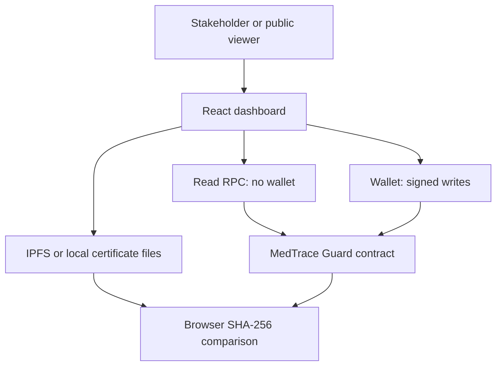

# Architecture and contract specification

## Components

No backend holds wallet private keys. The local test RPC unlocks disposable accounts for an explicit localhost-only demo. For remote chains, MetaMask signs all UI writes.

## Lifecycle and orthogonal safety flags

Manufactured → [propose/accept] → AtDistributor → [propose/accept] → AtPharmacy → [partial/full dispense] → Dispensed.

Recall and hold are independent flags, not replacements for custody stage, preserving the location/stage when a safety action occurs. Expiry is evaluated from the chain timestamp at each relevant write; no cron/oracle is needed to activate it. A pending shipment does not transfer legal/physical custody; it is a modeled acknowledgment workflow only.

| Operation | Preconditions | Main effects |
|---|---|---|
| registerBatch | Manufacturer; unique (manufacturer, exact code); valid future expiry, positive units, permitted range; nonzero SHA-256 | New ID, immutable batch metadata, initial custodian, history |
| proposeTransfer | Current custodian with matching stage role; next role only; eligible; no pending request; deadline within 7 days and expiry | Pending recipient, incremented nonce; custody unchanged |
| acceptTransfer | Named recipient, correct nonce, unexpired proposal; both parties still have expected roles; eligible | Custody/stage advance; pending request removed |
| cancelTransfer | Sender, recipient, or regulator; a pending request exists | Request removed; nonce remains consumed; entry preserved |
| dispense | Current pharmacy; positive units <= remaining; eligible | Remaining quantity decreases; zero remainder becomes Dispensed |
| reportTemperature | Current custodian with a role, or regulator; evidence hash; bounded value | Append observation; excursion sets hold; normal readings do not clear it |
| releaseHold | Regulator; existing hold; nonrecalled; nonzero review digest | Hold cleared; review logged; expiry still independently applies |
| recallBatch | Regulator; nonzero reason hash; not already recalled | Permanent recall; pending transfer removed; custody unchanged |

Temperature units are tenths of a degree Celsius throughout Solidity and telemetry JSON; UI uses degrees and converts. Registration supports -100.0 to 100.0 C policies. No claim is made that this is an appropriate real drug storage range; use synthetic examples.

## Invariants

- `0 <= remainingUnits <= totalUnits`; accumulated dispenses + remaining = initial units.
- Custody changes only on named-recipient acceptance, never on proposal.
- A consumed/cancelled nonce cannot accept a later proposal.
- Recalled, expired, held, and exhausted batches cannot advance or dispense.
- Only a regulator can release a hold; release never reverses recall or expiry.
- First registration metadata and prior history entries have no edit/delete API.
- History reads are capped at 100 entries/call; the UI uses pages of 20. Registry cards use pages of 12.

## Trust and threat model

Trusted: administrator's onboarding decisions, stakeholder key custody, regulator review judgment, underlying chain, wallet/RPC correctness, and certificate publisher's assertions. Untrusted: arbitrary callers, mistaken handoffs, stale nonces, altered certificate bytes, out-of-order transactions, unapproved recipients, and attempts to exceed quantity or bypass recorded safety flags.

Not solved: colluding stakeholders, counterfeit physical labels/QR cloning, omitted or false temperature reports, compromised administrator/regulator keys, malicious RPC gateways, traffic correlation, certificate unavailability, or preexisting false data. A certificate hash checks consistency, not issuer credentials or lab quality. All on-chain metadata is public; off-chain hash commitments can leak predictable information. Avoid sensitive data entirely in this prototype.

The administrator can reassign roles, which may temporarily strand custody. Regranting the expected role restores the demo flow; there is deliberately no emergency custody override. Admin succession uses nomination/acceptance. Production governance, multisig, timelocks, independent sensing, private storage, availability monitoring, and recovery procedures are future work.
