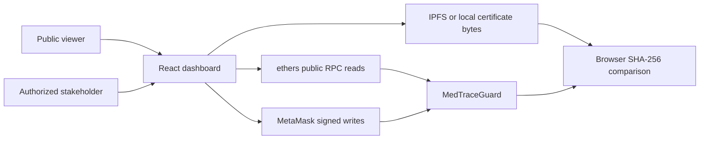

# Smart Contract Design Draft

**MedTrace Guard: Pharmaceutical Provenance with Accepted Custody and Safety Gates**  
Group 20 | CSE 540 | Fall B 2026 | October 29, 2026

Repository: https://github.com/hemanth-2104/MedTrace-Guard

## 1. Purpose and technical direction

The system provides a shared record of synthetic medicine batches as they move from manufacturer to distributor to pharmacy. A sender proposes a transfer and the named recipient accepts it before custody changes. On-chain rules prevent eligible workflow actions from bypassing recorded recalls, expiry, unresolved temperature holds, or exhausted inventory. Off-chain certificates are checked against registered SHA-256 digests.

The implementation is beyond the initial skeleton stage. This milestone document describes its architecture and public contract boundaries. It does not claim that the separate final report, demonstration videos, team agreement, or course submissions are complete.

## 2. Components and interactions



| Component | Responsibility | Source |
|---|---|---|
| MedTraceGuard | Role management, accepted custody, quantities, safety gates, append-only history | `contracts/MedTraceGuard.sol` |
| Documented public interface | Explicit signatures, data types, events, errors, intended behavior | `contracts/interfaces/IMedTraceGuard.sol` |
| MedTraceBaseline | Deliberately simpler comparison with one-step transfers and weaker gates | `contracts/MedTraceBaseline.sol` |
| Dashboard and wallet helper | Public lookup; explicit local-account or MetaMask signing; account/chain validation | `src/`, `shared/wallet.mjs` |
| Certificate helper | Fetch certificate bytes, compute SHA-256, report MATCH/MISMATCH/unavailable | `shared/certificate.mjs` |
| Deployment and evaluation | Compile, seed synthetic records, deploy locally/Amoy, test, benchmark | `scripts/`, `tests/` |

Local execution uses Ganache. The public demonstration uses Polygon Amoy (chain 80002). React uses ethers for contract interactions. Public reads need no wallet. Remote writes are signed by MetaMask; private keys are not stored by the frontend. The local demo explicitly uses disposable unlocked development accounts.

## 3. Roles and data model

The administrator assigns/revokes stakeholder roles and nominates a successor. The nominee must accept before authority changes. The administrator role is separate from `Role` and does not automatically grant manufacturer or regulator capabilities.

| Role | Intended actions |
|---|---|
| Manufacturer | Register batches; propose their initial shipment |
| Distributor | Accept manufacturer shipment; propose pharmacy shipment |
| Pharmacy | Accept distributor shipment; dispense units |
| Regulator | Record observations, cancel pending transfers, review/release holds, permanently recall |
| Public viewer | Read metadata, safety eligibility, certificate commitments, and history |

`Batch` records identifying metadata, manufacturer/current custodian, production/expiry dates, total/remaining units, temperature limits, custody stage, recall, and hold. `Pending` records recipient, deadline, and nonce. `Entry` records operation kind, actor, counterparty, timestamp, evidence digest, observation value, and units. Mappings index batches, roles, proposals, consumed nonces, manufacturer/code uniqueness, and history.

Dates use Unix seconds. Temperatures use tenths of a degree Celsius, so 20 means 2.0 C. Certificate bytes remain off-chain; the contract stores a locator and digest. History has no edit/delete API. No patient information is used.

## 4. Public interfaces and intended behavior

The independently compilable interface includes all 21 callable functions, four events, and six custom errors. Its ABI is automatically compared with the implementation using `npm run check:interface`.

| Function | Authorization and behavior |
|---|---|
| `assignRole(address, Role)` | Administrator only; nonzero account; None revokes privileges |
| `proposeAdmin(address)` / `acceptAdmin()` | Two-step administrator succession |
| `registerBatch(string,string,uint64,uint64,uint64,int32,int32,string,bytes32)` | Manufacturer only; validates metadata, dates, bounds, quantity, and digest; rejects duplicate manufacturer/code pairs; creates initial custody |
| `proposeTransfer(uint256,address,uint64)` | Eligible custodian with matching stage role; next role only; one pending proposal; future deadline within seven days and expiry |
| `acceptTransfer(uint256,uint64)` | Named recipient; current nonce; before deadline; both parties retain expected roles; safety rechecked; advances custody |
| `cancelTransfer(uint256)` | Current custodian, named recipient, or regulator; clears pending request while retaining consumed nonce/history |
| `dispense(uint256,uint64)` | Current pharmacy custodian; eligible batch; positive units within remaining quantity |
| `reportTemperature(uint256,int32,bytes32)` | Current custodian with an assigned role, or regulator; bounded value and nonzero evidence; excursion creates a persistent hold |
| `releaseHold(uint256,bytes32)` | Regulator; existing hold, no recall, nonzero review evidence; does not undo expiry |
| `recallBatch(uint256,bytes32)` | Regulator; nonzero reason; permanent recall and pending-request removal |
| `getBatch(uint256)` | Public metadata/state read; rejects unknown batch |
| `eligibility(uint256)` | Returns safety eligibility and reason: 0 eligible, 1 recalled, 2 expired, 3 held, 4 exhausted |
| `historyCount(uint256)` / `getHistory(uint256,uint256,uint256)` | Public history length/paging; page limit 1-100; past-end offset returns empty |
| `admin()`, `pendingAdmin()`, `batchCount()`, `roleOf(address)`, `pending(uint256)`, `transferNonce(uint256)` | Solidity-generated public state getters |

`eligibility` is a safety/inventory check, not a promise that a particular caller or transfer will be authorized. Complete parameter/return types appear in the commented Solidity interface.

Events: `RoleAssigned`, `AdminProposed`, `AdminChanged`, and `Recorded`. Custom errors: `Denied`, `UnknownBatch`, `InvalidInput`, `Blocked`, `InvalidTransfer`, and `DuplicateBatch`. Each business action appends an `Entry` and emits `Recorded`; role/admin changes use their dedicated events.

## 5. Lifecycle, safety rules, and invariants

```text
Manufactured --propose/accept--> AtDistributor
AtDistributor --propose/accept--> AtPharmacy
AtPharmacy --partial dispensing--> AtPharmacy
AtPharmacy --remaining becomes zero--> Dispensed
```

Proposal alone never changes custody. Acceptance uses a per-batch monotonic nonce to reject stale requests. Cancellation does not reuse a nonce. Recall and hold are independent flags, preserving custody stage. Expiry is evaluated from chain time on relevant operations.

- Remaining units stay between zero and initial total; dispensed plus remaining equals the initial quantity.
- Only the named recipient can accept a valid pending transfer, with expected sender/recipient roles.
- Held, recalled, expired, or exhausted batches cannot be proposed, accepted, or dispensed.
- An in-range observation cannot clear an earlier hold; a regulator review is required.
- Recall is permanent. Hold release does not bypass expiry or exhaustion.
- Registration metadata and previous history entries cannot be rewritten through the contract API.
- History responses are bounded to at most 100 entries per call.

The baseline is retained solely for evaluation. Its lower cost reflects a weaker design and less data; it is not a safe alternative to the main contract.

## 6. Dependencies, deployment, and validation

The root README supplies exact dependencies, fresh-clone setup, local startup, public-network configuration, and demonstration steps. Main contracts use Solidity 0.8.30, optimizer 200, via IR, and Shanghai target. The public contract is `0x95DDa069490E8D6B0650A707052598b306C495e2` on Amoy. Its implementation source is preserved unchanged; the new interface is compiled separately.

Run `npm ci`, `npm run verify`, `npm run check:interface`, and `npm run build:amoy` from the repository root. `npm start` starts the persistent local demonstration. `npm run benchmark` records baseline/Guard receipt gas and local read measurements. Tests use disposable in-memory chains rather than the saved user demonstration.

The October 26 evidence reports 68 passing automated tests and 75 completed software acceptance checks, including real MetaMask handoffs, public certificate verification, and user-confirmed phone lookup. Fresh publication results are recorded in `docs/PUBLICATION_CHECKS.md`; historical evidence remains dated. GitHub Actions repeats compilation, interface checks, automated tests, builds, and benchmarking.

## 7. Trust boundaries and limitations

The model trusts stakeholder onboarding, account custody, regulator judgment, underlying chain, and data publishers. Hashes prove consistency of bytes; they do not authenticate the issuer or prove medicine quality. Simulated readings are authorized assertions, not independent sensor evidence. Collusion, false/omitted reports, QR copying, compromised privileged keys, malicious RPCs, and certificate unavailability remain outside this prototype's guarantees. No production audit or regulatory certification is claimed.

Private environment files, saved chains, dependencies, generated build output, and duplicate archives are excluded from the public repository. Configuration examples leave signing keys empty. Historical final-report drafts, unsigned team templates, and video plans are explicitly labeled; their completion is a separate course milestone.

## 8. Team workflow and milestone submission

Existing proposal roster: Ananya Mishra, Hemanth Reddy Narendrababu, Sai Harsha Yerapothu, and Ridham Shah. Responsibilities and signatures must be agreed by the actual team; this document does not invent individual contributions or approvals. Use feature branches, review substantive changes, retain reproducible evidence, and have teammates review the design before submission. `docs/TEAM_CONTRACT.md` remains an unsigned template.

One team member uploads `Group20_2026FallB_CSE 540_MedTrace Guard Smart Contract Design.txt`, containing the public repository URL, to the designated course assignment. Confirm that the link opens publicly and that the latest submission is the intended file. The PDF is a convenient design copy; the supplied directions require the URL text file.

## 9. Rubric traceability

| Criterion (1.25 points each) | Evidence |
|---|---|
| GitHub repository setup | Public repository; named source, documentation, scripts, tests, and evidence folders |
| README documentation | Project description, pinned dependencies, install/run/deploy steps, roles, and usage |
| Contract structure and interfaces | Main/baseline contracts; full ABI interface aligned with implemented custody/safety workflow |
| Code documentation and comments | NatSpec on every interface function, type, event, and error; component responsibilities, preconditions, and invariants in this document |

The rubric totals 5 points. This mapping is a self-check, not an instructor grade or a guarantee of full credit.
